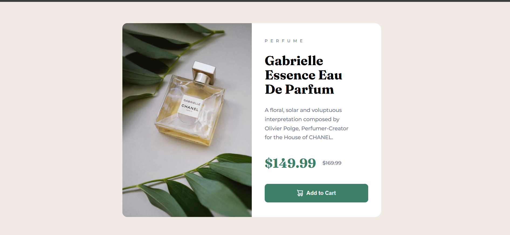

# Frontend Mentor - Product preview card component solution

This is a solution to the [Product preview card component challenge on Frontend Mentor](https://www.frontendmentor.io/challenges/product-preview-card-component-GO7UmttRfa). Frontend Mentor challenges help you improve your coding skills by building realistic projects.

## Table of contents

- [Overview](#overview)
  - [The challenge](#the-challenge)
  - [Screenshot](#screenshot)
  - [Links](#links)
- [My process](#my-process)
  - [Built with](#built-with)
  - [What I learned](#what-i-learned)
  - [Continued development](#continued-development)
  - [Useful resources](#useful-resources)
  - [AI Collaboration](#ai-collaboration)
- [Author](#author)
- [Acknowledgments](#acknowledgments)

**Note: Delete this note and update the table of contents based on what sections you keep.**

## Overview

### The challenge

Users should be able to:

- View the optimal layout depending on their device's screen size
- See hover and focus states for interactive elements

### Screenshot



### Links

- Solution URL: [Add solution URL here](https://github.com/manuel-https/product-preview-card-component-main)
- Live Site URL: [Add live site URL here](https://manuel-https.github.io/product-preview-card-component-main/)

## My process

### Built with

- Semantic HTML5 markup
- Flexbox
- Desktop-first workflow

### What I learned

Use this section to recap over some of your major learnings while working through this project. Writing these out and providing code samples of areas you want to highlight is a great way to reinforce your own knowledge.

```html
<picture class="img-container">
  <!-- Use a different image or crop for mobile viewports -->
  <source
    media="(max-width: 768px)"
    srcset="./images/image-product-mobile.jpg"
  />

  
</picture>
```

```css
@media (width < 450px) {
  main {
    flex-direction: column;
    margin-inline: 1rem;
    height: 50rem;
  }
  .main-img {
    width: 100%;
    border-radius: 12px 12px 0 0;
    height: auto;
  }

  .img-container {
    width: 100%;
  }

  .main-topic {
    width: 100%;
  }
}
```

-

## Author

- Frontend Mentor - [@manuel-https](https://www.frontendmentor.io/profile/yourusername)

## Acknowledgments

Thank you for being an amazing coding teacher. Your patience and guidance helped me learn how to program much better.
